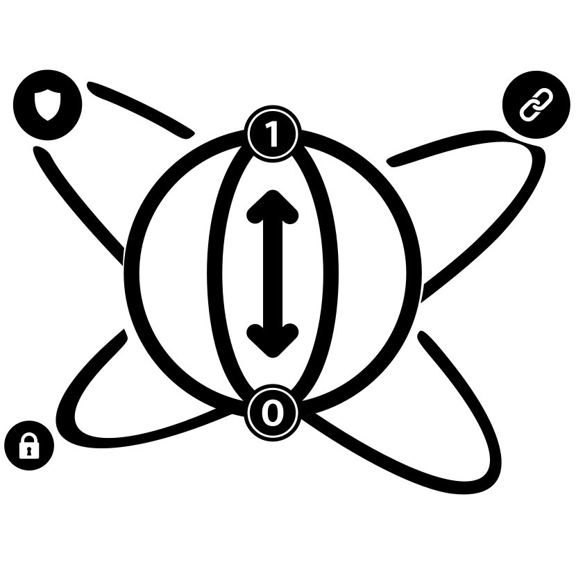

<p align="center">
  
</p>

<h1 align="center">qchain-backend</h1>

<p align="center">
  <b>The QChain API: the Go service between the apps, the post-quantum blockchain, IPFS and MySQL.</b><br/>
  It issues, stores, reads and verifies credentials signed with ML-DSA-44, encrypts their contents with ML-KEM-768, and is the only component that talks to the Hyperledger Fabric network.
</p>

<p align="center">
  
  
  
  
  
  
</p>

---

## 🌐 Live API

The API runs on our university VM and is reachable publicly through a Tailscale Funnel:

| Endpoint | What it is | Link |
|----------|-----------|------|
| **API** | the REST API that QPortal and QWallet call | **https://qchain.tail4fff4b.ts.net/api** |
| **Health** | liveness probe | **https://qchain.tail4fff4b.ts.net/api/health** → `{"status":"ok"}` |
| **QPortal** | the web portal, hosted on Vercel (the old address `https://qchain.tail4fff4b.ts.net/` redirects to it) | **https://qportal.vercel.app** |

> ⚠️ **It's a live demo, not production.** It runs on a single shared VM, so it may be offline at times,
> the demo database is shared by everyone, and the API has no caller authentication yet.

---

## Overview

Today's blockchains sign data with classical cryptography (RSA, ECDSA), which a sufficiently powerful quantum
computer running **Shor's algorithm** would break. **QChain** signs every credential with **ML-DSA-44
(CRYSTALS-Dilithium)**, a NIST-standardised post-quantum signature, and anchors it on a permissioned
**Hyperledger Fabric** network whose own identities are ML-DSA-44 as well.

This repository is the **backend**: one Go service, used by both apps.

- **QPortal** (issuers, verifiers, IT admins) calls the portal endpoints.
- **QWallet** (holders) calls the `/mobile/*` endpoints.
- The backend writes and reads the ledger through the **Fabric Gateway**, stores each credential's encrypted body on
  **IPFS**, and keeps in **MySQL** only the data that exists nowhere else (Emirates ID mapping, contact details,
  sessions, subscriptions, alerts, staff, audit, history).

It follows a **hash-on-chain, data-off-chain** model: the ledger holds a small signed record (metadata, the IPFS CID
and a salted SHA3-256 fingerprint of every field), while the attributes live only on IPFS, encrypted to the
holder's ML-KEM-768 key.

---

## Architecture

```
          QPortal (Vercel)                QWallet (mobile)
                  │                               │
                  └──────────── HTTPS ────────────┘
                                  │
          https://qchain.tail4fff4b.ts.net   ──  Tailscale Funnel  (443, auto-HTTPS)
                                  │
                                  ▼
                 gateway/  ·  Nginx container  ·  :8090
            /api/ → backend      /gw-health      / → 302 to QPortal
                                  │
                                  ▼
             Go REST API  ·  main.go + api/ db/ ledger/ pqc/ config/  ·  :3000
        ┌──────────────────────┬────────────────────┬────────────────────┐
        ▼                      ▼                    ▼                    ▼
  Hyperledger Fabric        IPFS (Kubo)           MySQL           ML-DSA-44 / ML-KEM-768
  (qchain-network repo)     :5001                 :3306           liboqs-go (CGo) and
  ML-DSA-44 identities,     encrypted envelopes   IDs, contacts,  Go 1.27 crypto/mldsa
  chaincode qchaincode      (CID on-chain)        sessions, audit
```

- **Source of truth:** the chain for every field it holds (status, type, dates, holder name and keys, CID, hashes),
  IPFS for the credential body, MySQL only for data that exists nowhere else. No store is a fallback for another.
- **Authenticity:** the issuer's ML-DSA-44 signature over a canonical commitment (holder, type, issue and expiry
  dates, CID and every salted field hash).
- **Verification:** `/resolveSession` rebuilds that commitment from the ledger, checks the issuer signature against
  the pinned issuer key, checks each disclosed value and salt against its on-chain fingerprint, and checks the
  holder's ML-DSA-44 signature over the presentation. Every check runs, every time.

---

## Post-quantum coverage

| What | Algorithm | Where in this repository |
|------|-----------|--------------------------|
| Credential signature (issuer) | ML-DSA-44 | `pqc/crypto.go`, `pqc/commitment.go` (liboqs-go) |
| Credential body | ML-KEM-768 + AES-256-GCM, encrypted to the holder's key | `pqc/envelope.go`, `pqc/kem.go` |
| Commitment and field fingerprints | SHA3-256, salted | `pqc/commitment.go` |
| Presentation signature (holder) | ML-DSA-44, made on the phone, checked here | `api/verification.go` |
| Transactions submitted through the Fabric Gateway | ML-DSA-44 | `ledger/fabric.go` (Go 1.27 `crypto/mldsa`) |
| Fabric identities (orderer, peers, admins, users) | ML-DSA-44 | the network, see [qchain-network](https://github.com/teamqchain/qchain-network) |

**Checked on the live network (7 November 2026):** every certificate in the network's crypto material and in the
newest block carries the ML-DSA-44 OID `2.16.840.1.101.3.4.3.17`, and the end-to-end API test passed 123/123.

---

## Technology stack

| Layer | Technology |
|-------|------------|
| Language | Go 1.27 |
| Post-quantum cryptography | ML-DSA-44 (NIST FIPS 204) and ML-KEM-768 (NIST FIPS 203) via **liboqs-go**; Go 1.27 `crypto/mldsa` for Fabric Gateway signing |
| Blockchain client | `hyperledger/fabric-gateway` |
| Off-chain storage | IPFS / Kubo through `go-ipfs-api` |
| Database | MySQL 8 through `go-sql-driver/mysql` |
| Packaging | Docker (multi-stage: liboqs built from source, then a slim runtime image) |
| Public entry point | Nginx gateway + Tailscale Funnel |
| CI/CD | GitHub Actions on a self-hosted runner on the VM, with automatic rollback |

---

## Repository structure

```
qchain-backend/
├── main.go                 # entry point: configuration, route registration, CORS, startup
├── bootstrap.go            # RUN_CHAIN_BOOTSTRAP=1 one-shot: re-registers holders after a ledger reset
├── api/                    # HTTP handlers
│   ├── credentials.go      #   issue, update, revoke, suspend, restore, list, detail
│   ├── verification.go     #   /resolveSession: the five checks against the chain
│   ├── mobile.go           #   QWallet endpoints under /mobile/*
│   ├── holders.go dashboard.go staff.go subscriptions.go
│   └── httputil.go         #   JSON helpers shared by every handler
├── db/                     # MySQL access
│   ├── db.go               #   the connection and the display-ID counters
│   ├── audit.go credentials.go dashboard.go holders.go mobile.go
│   ├── staff.go subscriptions.go verification.go util.go
│   └── schema.sql          #   the whole database schema (load once)
├── ledger/                 # Hyperledger Fabric
│   ├── fabric.go           #   Gateway connection, ML-DSA-44 identities from the wallet
│   └── chain.go            #   typed reads and writes of the ledger (the source of truth)
├── pqc/                    # post-quantum cryptography
│   ├── crypto.go           #   ML-DSA-44 sign / verify, SHA3-256
│   ├── kem.go envelope.go  #   ML-KEM-768 envelope encryption of the credential body
│   └── commitment.go       #   what the issuer's signature covers
├── config/                 # settings from the environment, shared by every package
├── cmd/
│   ├── keygen/             # issuer ML-DSA-44 key pair; holder helpers used by the end-to-end test
│   └── mkwallet/           # builds a Fabric wallet identity from an ML-DSA MSP folder
├── docker/                 # Dockerfile, docker-build.sh, docker-run.sh
├── gateway/                # the Nginx gateway (Dockerfile, nginx.conf, scripts, Tailscale Funnel setup)
├── scripts/                # setup-demo.sh, start-demo.sh, setup-ipfs-service.sh
├── tests/
│   └── e2e_api_test.sh     # end-to-end test against a running stack: every endpoint, 123 assertions
├── .github/workflows/      # deploy-backend.yml, deploy-gateway.yml
├── .env.example            # template for .env (never commit .env: it holds the issuer's private key)
└── go.mod · go.sum · LICENSE
```

Unit tests live next to the code they test (`*_test.go` in `api/`, `config/`, `ledger/`, `pqc/` and `cmd/mkwallet/`).

---

## Getting started

This sets up the backend on a Linux host (the project runs on an Ubuntu VM). The Fabric network comes from the
[qchain-network](https://github.com/teamqchain/qchain-network) repository and must be running first.

### Prerequisites

| Tool | Version | Used for |
|------|---------|----------|
| Docker | latest | building and running the API and the gateway |
| The QChain Fabric network | see qchain-network | the ledger, wallets and connection files the API needs |
| MySQL | 8.x | the `qchain_db` database |
| IPFS / Kubo | latest | off-chain credential storage |
| Tailscale | latest | optional, only for public access |

### 1. Clone, next to qchain-network

The API reads the network's wallets and certificates from the `qchain-network` clone **next to** this one:

```bash
mkdir -p ~/teamqchain && cd ~/teamqchain
git clone https://github.com/teamqchain/qchain-network.git     # set it up first, see its README
git clone https://github.com/teamqchain/qchain-backend.git
cd qchain-backend
```

(Elsewhere? Set `NETWORK_DIR` to the network folder when running `docker/docker-run.sh`.)

### 2. Database

```bash
mysql -u root -p -e "CREATE DATABASE qchain_db CHARACTER SET utf8mb4;"
mysql -u root -p qchain_db < db/schema.sql
```

### 3. IPFS

```bash
ipfs init                              # first time only
bash scripts/setup-ipfs-service.sh     # IPFS as a systemd user service (starts on login, restarts on crash)
```

### 4. Build the API image

```bash
bash docker/docker-build.sh            # first build ~20 min (liboqs compiles from source); later ~2 min
```

### 5. Configure

```bash
docker run --rm qchain-api:latest keygen    # prints the organisation's ML-DSA-44 key pair as .env lines
cp .env.example .env                        # then fill in the key pair and MYSQL_DSN
chmod 600 .env                              # it holds the private key
```

### 6. Run

```bash
bash docker/docker-run.sh
curl -s http://localhost:3000/health        # → {"status":"ok"}
bash scripts/setup-demo.sh                  # optional: demo holders
```

### 7. Public access (optional)

```bash
bash gateway/docker-build.sh && bash gateway/docker-run.sh    # Nginx on :8090
bash gateway/setup-tailscale-funnel.sh                         # https://<machine>.<tailnet>.ts.net
```

### Quick start (machine already set up)

```bash
bash scripts/start-demo.sh     # starts IPFS and the API container, checks the Fabric containers
```

---

## Testing

```bash
# Unit tests (52; ML-DSA-44 and ML-KEM-768 need liboqs, which the image's builder stage has)
docker build --target builder -f docker/Dockerfile -t qchain-api:test .
docker run --rm qchain-api:test go test -count=1 ./...

# End-to-end, against a running stack (plays issuer, verifier, admin and holder; writes test records)
bash tests/e2e_api_test.sh
```

With Go 1.27 and liboqs installed locally, `go vet ./... && go test ./...` works from the repository root too.

---

## Continuous deployment

Pushing to `main` redeploys automatically on the VM through a GitHub Actions self-hosted runner. Watch runs in
the **Actions** tab.

| Push touches | Workflow | What it does |
|---|---|---|
| Go code, `go.mod`/`go.sum`, `docker/` | `deploy-backend.yml` | `go test` → rebuild → restart `qchain-api` → `/health` |
| `gateway/` | `deploy-gateway.yml` | rebuild → restart `qchain-web-gateway` → `/gw-health` and the `/` redirect |

- A failed test or build leaves the running container untouched.
- If a new container fails its health check, the previous image is restarted automatically, and the run is marked
  failed (GitHub emails the pusher).
- **Still manual:** the MySQL schema (`db/schema.sql`) and anything in the network (chaincode, channel).
- Either workflow can be run by hand: Actions → the workflow → **Run workflow**.
- The workflows deploy from the VM's own checkout at `~/Desktop/QChain/teamqchain/qchain-backend`, because they need
  its `.env` and the network's runtime files next to it.

---

## API reference

Base URL: `http://localhost:3000`, or `https://qchain.tail4fff4b.ts.net/api` through the gateway. All
credential-related responses include a `credentialID`, and **all timestamps are UAE local time (Asia/Dubai)**.

**Credentials**
| Method | Path | Purpose |
|--------|------|---------|
| POST | `/registerHolder` | Register a credential holder on-chain |
| POST | `/issueCredential` | Issue a credential: salted field hashes + expiry on-chain, envelope encrypted to the holder on IPFS, issuer ML-DSA-44 signature over the commitment |
| POST | `/updateCredential` | Update the holder email (MySQL) and/or expiry (re-signed on-chain) |
| POST | `/revokeCredential` · `/suspendCredential` · `/restoreCredential` | Lifecycle changes (on-chain) |
| GET | `/getAllCredentials` · `/getCredentialDetail` | Read credentials (on-chain fields from the ledger) |

**Verification**
| Method | Path | Purpose |
|--------|------|---------|
| POST | `/resolveSession` | Verify a holder's QR/OTP presentation (5 checks against the chain) |
| GET | `/getVerificationHistory` · `/getVerificationDetail` | Verification logs |

**Holders, dashboard, audit**
| Method | Path | Purpose |
|--------|------|---------|
| GET | `/getHolders` | List holders |
| GET | `/getDashboardStats` | Dashboard widgets (counts, recent activity, status alerts) |
| GET | `/getAuditLogs` | Append-only audit log |

**Subscriptions and alerts** (verifier monitoring)
| Method | Path | Purpose |
|--------|------|---------|
| POST | `/requestSubscription` · `/deleteSubscription` · `/unsubscribe` | Manage subscriptions |
| GET | `/getSubscriptions` | List subscriptions |
| GET | `/getSubscriptionAlerts` | Alerts (raised when a monitored credential is suspended or revoked) |
| POST | `/acknowledgeAlert` | Acknowledge an alert |

**Staff and directory** (IT admin)
| Method | Path | Purpose |
|--------|------|---------|
| GET | `/getStaff` · `/getDirectory` | Staff list, organisation directory |
| POST | `/inviteStaff` · `/updateStaffRole` · `/deleteStaff` | Staff management |

**QWallet (mobile)**, under `/mobile/*`
| Method | Path | Purpose |
|--------|------|---------|
| GET | `/mobile/checkKeys` · `/mobile/getHolderProfile` | Holder keys and profile (keys and name from the chain) |
| POST | `/mobile/registerHolderKeys` | Bind the wallet's ML-KEM-768 + ML-DSA-44 public keys on-chain |
| GET | `/mobile/getEnvelope` | Encrypted credential envelope, fetched from IPFS by the on-chain CID |
| GET | `/mobile/getCredentialsByHolder` · `/mobile/getActivity` · `/mobile/getCatalog` · `/mobile/getSubscriptions` | Wallet reads |
| POST | `/mobile/toggleFavorite` · `/mobile/fetchDocument` | Wallet actions |
| POST | `/mobile/generateOTP` · `/mobile/generatePresentation` | Create a share session (OTP / QR) |
| POST | `/mobile/approveSubscription` · `/mobile/rejectSubscription` | Respond to verifier requests |
| GET | `/health` | Liveness probe |

---

## Recent updates

- **Own repository (9 November 2026).** The backend moved out of the former `QChain-PQC-blockchain` monorepo with its
  full history, and its Go code was organised into `api/`, `db/`, `ledger/`, `pqc/` and `config/` packages.
  The gateway is API-only now: QPortal is hosted on Vercel, and the gateway's root redirects there.
- **Post-quantum Fabric identities, live since 7 November 2026.** The backend signs its Fabric Gateway transactions
  with ML-DSA-44 identities (Go 1.27 `crypto/mldsa`), and its default peer endpoints match the new network.

---

## Documentation

- [Setup guide](https://github.com/teamqchain/qchain-docs/blob/main/docs/setup.md): the whole system from scratch (Fabric network, database, IPFS, this backend, the apps, CI/CD runner)
- [gateway/README.md](gateway/README.md): the Nginx gateway and the Tailscale Funnel runbook
- [qchain-network README](https://github.com/teamqchain/qchain-network#readme): the Fabric network this backend talks to: ports, identities, ledger reset
- [qchain-docs](https://github.com/teamqchain/qchain-docs): the project's reports and the earlier benchmarks

---

## Related repositories

| Repository | What it holds |
|------------|---------------|
| [qchain-portal](https://github.com/teamqchain/qchain-portal) | QPortal, the web portal for issuers, verifiers and IT admins |
| [qchain-wallet](https://github.com/teamqchain/qchain-wallet) | QWallet, the holder's mobile app |
| [qchain-shared](https://github.com/teamqchain/qchain-shared) | the shared Flutter package: certificate template and viewer |
| [qchain-backend](https://github.com/teamqchain/qchain-backend) | this repository |
| [qchain-network](https://github.com/teamqchain/qchain-network) | the Hyperledger Fabric network with ML-DSA-44 identities, and the chaincode |
| [qchain-docs](https://github.com/teamqchain/qchain-docs) | reports, the setup guide and the preliminary benchmarks |
| [qchain-kpi](https://github.com/teamqchain/qchain-kpi) | the post-quantum performance benchmarks |
| [teamqchain.github.io](https://github.com/teamqchain/teamqchain.github.io) | the project website |

Some of these repositories are private.

---

## Team

A University of Sharjah capstone project, supervised by **Dr. Manar Abu Talib** and **Dr. Sohail Abbas**.

| Member | Role |
|--------|------|
| Mohammed Bin Ali Maqqavi ([@M0hd-Maqqavi](https://github.com/M0hd-Maqqavi)) | Project Manager |
| Mohammed Abdul Haris ([@mohammed-ah-14](https://github.com/mohammed-ah-14)) | Technical Lead |
| Mohammed Nihal ([@nihvp](https://github.com/nihvp)) | Quality Assurance Lead |
| Mohammed Obeid ([@MohammedObeid88](https://github.com/MohammedObeid88)) | Blockchain Specialist |

---

## License

**Proprietary — all rights reserved.** © 2026 QChain. This source code is proprietary and confidential;
unauthorized copying, modification, distribution, or use is prohibited without prior written permission.
See [LICENSE](LICENSE).

---

## Disclaimer

This is an academic research project, not a production system. The public demo uses seed/demo data on a shared
database, and the API has no caller authentication yet: the OTP/QR presentation flow and the portal endpoints are
tracked for a future session/login system. Credential confidentiality and holder-key handling are implemented
today: attributes are encrypted end-to-end to an ML-KEM-768 key pair generated and held only on the holder's
device, never transmitted to or stored by the backend.
